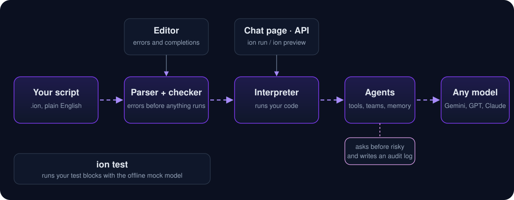

<p align="center">
  
</p>

<p align="center">
  <a href="LICENSE"></a>
  
  <a href="https://github.com/vaishnav-rs/ionlang/actions/workflows/ci.yml"></a>
  
</p>

<h3 align="center">If you can describe it, you can write it in Ion.<br>Then give it a team of AI agents to do the hard parts.</h3>

<p align="center">
  <a href="#-see-it-in-30-seconds">See it</a> ·
  <a href="#-install">Install</a> ·
  <a href="#-the-language-in-one-tour">Language tour</a> ·
  <a href="#-how-it-runs">How it works</a> ·
  <a href="SPEC.md">Spec</a> ·
  <a href="LANGUAGE.md">10-minute guide</a> ·
  <a href="CONTRIBUTING.md">Contribute</a>
</p>

---

## ✨ See it in 30 seconds

Here is a small team of AI agents. You can read it aloud and understand it:

```ion
agent researcher:
    model "gemini/gemini-2.5-flash"
    key from env "GEMINI_API_KEY"
    can browse web

agent writer:
    model "anthropic/claude-sonnet-5-5"
    key from env "ANTHROPIC_API_KEY"
    can access files in "./reports"

team newsroom:
    lead writer
    members researcher

serve newsroom
```

Run `ion run newsroom.ion`. A chat page opens. You talk to the team, the writer hands research to the researcher when it needs facts, and the team asks you before it browses the web or touches your files.

**No API key yet? Run this instead.** It uses the built-in offline `mock` model, so it works right now:

```ion
tool shout(text):
    describe "Makes text loud"
    give back upper(text) + "!"

agent echo:
    model "mock"
    can use shout

say ask echo 'CALL shout {"text": "tools are functions agents can call"}'
```

```
Done: TOOLS ARE FUNCTIONS AGENTS CAN CALL!
```

---

## 🧠 Why Ion

| | |
|---|---|
| **📖 It reads like English.** | `set total to 0`, `for each price in prices:`, `if age is at least 18:`. No brackets to match, no semicolons, no jargon to learn first. |
| **🤖 Agents are part of the language.** | An agent is a line with a model, a role and some abilities. A team is a line that names a lead and its members. You don't import a framework to get them. |
| **🛡️ Safe by default.** | An agent can only do what you gave it (`can browse web`, `can access files in "./notes"`). Anything risky asks you first. Every run keeps an audit log, and you can cap spending with a token budget. |
| **🧪 Testable without an API key.** | Write `test` blocks with `assert`. `ion test` runs them against the offline `mock` model, so tests cost nothing and never touch the network. |
| **🧰 One tool for everything.** | `ion run`, `check`, `test`, `fmt`, `repl`, `preview`, plus a language server for your editor. |
| **🔌 Any model.** | Gemini, OpenAI, Anthropic, OpenRouter, Groq, Cerebras, or your own endpoint. Add a fallback model, and Ion switches over if the first one is down or rate-limited. |

---

## 📦 Install

**Easiest: download the program for your system** from the [Releases page](https://github.com/vaishnav-rs/ionlang/releases). No Node.js needed.

| System | Download | Then |
|---|---|---|
| Windows | `ion-windows-x64.zip` | Unzip it, and put `ion.exe` somewhere on your PATH |
| macOS (Apple Silicon or Intel) | `ion-macos-arm64.dmg` or `ion-macos-x64.dmg` | Open it, and copy `ion` to `/usr/local/bin` |
| Linux | `ion-linux-x64.tar.gz` | Extract it, and move `ion` to `/usr/local/bin` |

Then open a new terminal and check it works: `ion --version`.

**Building from source** needs [Node.js](https://nodejs.org) 20 or newer.

**Windows (PowerShell):**

```powershell
powershell -ExecutionPolicy Bypass -File scripts\install.ps1
```

**macOS or Linux:**

```sh
sh scripts/install.sh
```

Then open a new terminal and check:

```
ion --version
0.1.0 (Ion language 1.0)
```

Prefer to do it by hand? `npm install`, then `npm run build`, then `npm link`.

---

## 🚀 Your first program

Create `hello.ion`:

```ion
set name to "world"
say "Hello, {name}!"
```

Run it:

```
ion run hello.ion
```

```
Hello, world!
```

That's the whole loop. `{name}` puts a value into text, and you can put any expression inside the braces: `"Next year you'll be {age + 1}."`

Want a guided start? [LANGUAGE.md](LANGUAGE.md) takes ten minutes, and the `learn/` folder has five hands-on lessons with "your turn" challenges.

---

## 📚 The language in one tour

Everything below runs. Where a snippet uses a real AI model, it's shown without the run, since you'd need an API key.

### Values and text

```ion
set name to "Ada"
set age to 36
say "Hello, {name}! Next year you'll be {age + 1}."
```

```
Hello, Ada! Next year you'll be 37.
```

Text is in quotes. Numbers, `yes`/`no`, and `nothing` are values too. Use `\{` if you really want a brace.

### Decisions

```ion
set name to "Ada"
set age to 36
if age is at least 18:
    say "{name} can vote"
otherwise:
    say "{name} is too young to vote"
```

```
Ada can vote
```

The comparisons are words: `is`, `is not`, `is greater than`, `is less than`, `is at least`, `is at most`, `contains`, `starts with`. Blocks are indented, and a line that ends in `:` starts one.

### Lists and loops

```ion
set fruits to ["apple", "pear"]
add "fig" to fruits
for each fruit in fruits:
    say "I like {fruit}"
say "{length(fruits)} fruits"
```

```
I like apple
I like pear
I like fig
3 fruits
```

Positions start at `0`, and `fruits[-1]` is the last one. `repeat 3 times:`, `while count is less than 10:` and `repeat forever:` work too, with `stop` and `skip`.

### Maps and totals

```ion
set person to {name: "Ada", langs: ["Ion", "Python"]}
say person.name
say person.langs[-1]

set total to 0
for each price in [4, 5, 6]:
    set total to total plus price
say "Total: {total}"
```

```
Ada
Python
Total: 15
```

### Functions

```ion
to greet(name):
    give back "Hello, " + name + "!"

say greet("world")
```

```
Hello, world!
```

Functions are values, so you can pass them around: `map(prices, double)`.

### Errors you can handle

```ion
try:
    set data to json("not json")
on error as problem:
    say "Couldn't read it: {problem}"
```

```
Couldn't read it: That text isn't valid JSON.
```

When Ion can't do something, the message says what happened and, usually, how to fix it.

### Agents

```ion
agent poet:
    model "mock"
    role "You write haiku."

set reply to ask poet "Write about the sea"
say reply
```

```
mock reply: Write about the sea
```

`mock` is an offline stand-in that echoes what you send, which is perfect for trying things. Swap it for a real model and you get an actual haiku:

```ion
agent poet:
    model "gemini/gemini-2.5-flash"
    key from env "GEMINI_API_KEY"
    role "You write haiku."
```

Every agent needs a model. Add `fallback "openai/gpt-4o-mini"` and Ion switches to it when the first model is unavailable.

### Tools: functions an agent can choose to use

```ion
tool shout(text):
    describe "Makes text loud"
    give back upper(text) + "!"

agent echo:
    model "mock"
    can use shout

say ask echo 'CALL shout {"text": "tools are functions agents can call"}'
```

A tool is a function you write. The `describe` line tells the agent what it's for, and `can use` gives it to the agent. A real model decides when to call it. The mock calls it when you write `CALL`, so you can test the wiring.

### Teams

```ion
tool word_count(text):
    describe "Counts the words in a piece of text"
    give back length(split(text))

agent reporter:
    model "mock"
    role "You write short, accurate news summaries."
    can use word_count

agent editor:
    model "mock"
    role "You check copy and pass writing to the reporter."
    can ask reporter

team newsroom:
    lead editor
    members reporter
```

The editor talks to the reporter, and the reporter uses its tools. The lead is who you talk to, and every delegation and tool call is recorded in the run log.

### Talking to people

```ion
set answer to ask user "What's your name?"
say "Nice to meet you, {answer}."
```

`ask user` waits for a person. `chat with writer` opens a conversation in your terminal, and `serve newsroom on port 4310` opens a chat page and an API for the team.

### Tests that run without an API key

```ion
to double(n):
    give back n times 2

test "doubling works":
    assert double(4) is 8
```

Run `ion test` on the file. A failing check says what it expected and what it got:

```
tests.ion
  ok    doubling works
  FAIL  total is right
        tests.ion:8: I expected 9, but it was 8.

1 passed, 1 failed
```

`test` blocks are ignored by `ion run`, so they cost nothing in a finished program.

### Splitting code across files

```ion
use "helpers.ion"
say greet("world")
```

`use` runs another file once and makes its names available. Its path is relative to the file that contains the line.

---

## 🏗️ How it runs

<p align="center">
  
</p>

Ion reads your whole file before it runs a line, so a syntax mistake stops you at once instead of halfway through a long job. `ion check` goes further and finds things like an unknown agent name, without running anything or calling any AI. Your editor uses the same checker.

---

## 🛡️ Safety, built in

Agents are the part of Ion most likely to do something you didn't expect, so they're the part we've been most careful with.

- **Abilities are explicit.** An agent can browse the web only if it says `can browse web`. It can read a folder only if it names one. Everything else is off.
- **Risky things ask first.** The first time an agent reads your files, browses, runs a command, or reads Gmail, you're asked. `--yes` approves without asking, and tests deny by default.
- **Secrets stay secret.** Keys are read from environment variables, and Ion hides any secret it knows about in logs, traces and error messages.
- **Every run leaves a record.** Each run writes a log of model calls, tool calls and permission decisions to `.ion/logs/`. By default it holds metadata only, not your messages. Add `--log-content` if you want the text too.
- **Spending has a ceiling.** `ion run file.ion --budget 200000` stops once that many model tokens have been used.

Ion is not a complete sandbox. An agent you trust with `can run commands` can do what your account can do, and a web page an agent reads can try to give it instructions. Read [SECURITY.md](SECURITY.md) for the honest details.

---

## 🧰 Commands

| Command | What it does |
|---|---|
| `ion run <file>` | Run a script. A `serve` line starts a chat page and API. |
| `ion check <file>` | Find mistakes without running anything or calling any AI. |
| `ion test <file or folder>` | Run the `test` blocks. |
| `ion fmt <file>` | Tidy indentation and spacing. `--check` only reports. |
| `ion repl` | Try Ion one line at a time. |
| `ion preview [file]` | Open the chat page. With no file, it opens a demo team that needs no key. |
| `ion lsp` | Run the language server for editors. |
| `ion --version` | Show the Ion and language versions. |

Useful run options: `--data <folder>` keeps conversations between runs. `--budget <tokens>` caps spending. `--trace` prints each step as it happens. `--yes` approves permission prompts. `--no-log` turns off the run log.

**Editor support:** a VS Code extension in [`editors/vscode`](editors/vscode) gives you highlighting, errors as you type, and completions.

---

## 🗂️ Examples and learning

| Where | What's there |
|---|---|
| [`examples/newsroom.ion`](examples/newsroom.ion) | A small team with a tool and tests. Runs offline. |
| [`examples/tools-and-memory.ion`](examples/tools-and-memory.ion) | Tools and an agent that remembers. Runs offline. |
| [`examples/hello.ion`](examples/hello.ion) | The smallest useful program. |
| [`learn/`](learn) | Five hands-on lessons, from `say` to teams. |
| [`LANGUAGE.md`](LANGUAGE.md) | The ten-minute guide. |
| [`guide/Ion-Guide.pdf`](guide/Ion-Guide.pdf) | The full book: every feature, with exercises and answers. |
| [`SPEC.md`](SPEC.md) | The reference: every statement, operator, setting and built-in function. |

---

## 🧭 Where Ion is today

Ion is young, and it's honest about that:

- ✅ The language, the agents, teams, tools, tests, the formatter, the language server, and the audit log all work and are tested.
- ✅ Gemini, OpenAI, Anthropic, OpenRouter, Groq and Cerebras are supported, plus any endpoint that speaks their formats. The test suite checks their request and response handling against stand-in responses, so it makes no live API calls. Run a real key once to confirm your setup.
- 🚧 **Packages.** You share code with `use "file.ion"` today. Installing and publishing packages is not built yet.
- 🚧 **Hosting.** Ion runs on your computer. There's no hosted version yet.
- 🚧 **Per-user limits.** Budgets and conversation storage are per process, not per user.
- 📜 **Old syntax.** Files that begin with `ion init` still run. New scripts should use the syntax on this page.

Ion's [spec](SPEC.md) promises that a script which works in language version 1.0 keeps working for the whole version, and it explains how changes are made.

---

## 🤝 Contributing

Ion is open source, and contributions are welcome: bug fixes, examples, documentation, and language ideas. Start with [CONTRIBUTING.md](CONTRIBUTING.md), and report security problems privately through [SECURITY.md](SECURITY.md).

```sh
npm install
npm test
```

---

## 📄 License

Ion is licensed under the [Apache License 2.0](LICENSE). See [NOTICE](NOTICE) for the copyright line.

<p align="center">
  <sub>Made with plain English, one <code>say</code> at a time.</sub>
</p>
